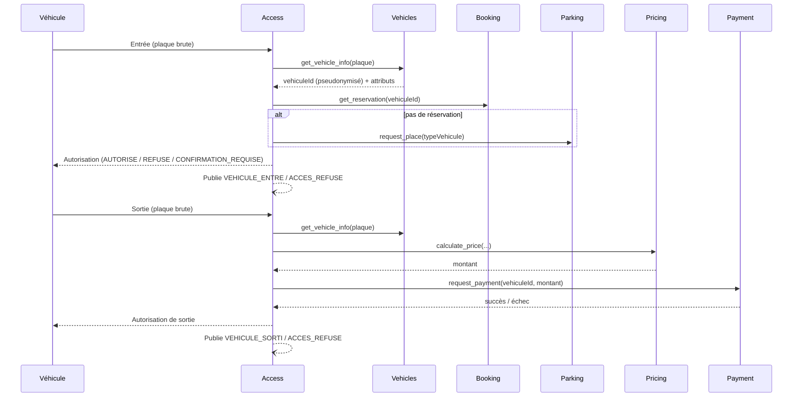

# Access — microservice de gestion des accès parking

> Décide si un véhicule peut **entrer** ou **sortir** du parking et coordonne les
> échanges nécessaires avec les services **Vehicles**, **Booking**, **Parking**,
> **Pricing** et **Payment**. Fait partie du projet fil rouge "Gestion d'un
> parking" (voir `.claude/access-microservice-spec.md` pour la spécification
> complète, et `.claude/consignes.md` pour le contexte du projet global).

---

## Sommaire

1. [Présentation](#1-présentation)
2. [Prérequis & installation](#2-prérequis--installation)
3. [Lancement & Swagger](#3-lancement--swagger)
4. [Architecture hexagonale](#4-architecture-hexagonale)
5. [Brancher un vrai microservice à la place d'un mock](#5-brancher-un-vrai-microservice-à-la-place-dun-mock)
6. [Ajouter une règle métier](#6-ajouter-une-règle-métier)
7. [Enums (tables de correspondance)](#7-enums-tables-de-correspondance)
8. [Tests](#8-tests)
9. [Sécurité](#9-sécurité)
10. [Endpoints](#10-endpoints)
11. [Postman](#11-postman)
12. [Écarts assumés par rapport à la spec](#12-écarts-assumés-par-rapport-à-la-spec)

---

## 1. Présentation

Access est le **point central** du workflow d'entrée/sortie du parking. Il ne
possède **aucune donnée métier des autres services** (identité véhicule,
réservations, disponibilité des places, tarifs, transactions) : il les
interroge via 5 ports dédiés (mockés pour ce MVP) et ne conserve en propre
que ses propres objets métier (`DemandeAcces`, `AutorisationAcces`,
`EvenementAcces`) plus un cache technique de présence (`vehicle_presence`).



**Règle absolue (RGPD) : la plaque brute n'est utilisée qu'à un seul endroit**
de toute la codebase — l'appel `VehiclesServicePort.get_vehicle_info(plaque)`
depuis les use cases `ProcessEntryRequest` / `ProcessExitRequest` /
`CheckPlateKnown`. Elle n'est **jamais** persistée, publiée dans un événement,
renvoyée par l'API, ni écrite dans un log (un filtre de logging redonde même
cette garantie en profondeur, voir [section 9](#9-sécurité)).

---

## 2. Prérequis & installation

- Python 3.11+ (testé avec 3.12)

```bash
# Toujours travailler dans un environnement virtuel — jamais d'installation globale.
python -m venv .venv

# Activation
source .venv/bin/activate        # macOS / Linux
.venv\Scripts\activate            # Windows

pip install -r requirements.txt

# Configuration
cp .env.example .env
# Ajustez .env si besoin (API_KEY, EVENT_SUBSCRIBERS_URLS pour brancher vos
# coéquipiers en local, etc.)
```

---

## 3. Lancement & Swagger

```bash
uvicorn src.interfaces.api.main:app --reload --port 8000
```

- Swagger UI : http://localhost:8000/docs
- ReDoc : http://localhost:8000/redoc
- Healthcheck (sans clé API) : http://localhost:8000/health

Toutes les autres routes exigent l'en-tête `X-API-Key` (valeur de `API_KEY`
dans `.env`, `change-me` par défaut). Dans Swagger, cliquez sur **Authorize**
et collez la clé.

Un registre de plaques de démonstration est câblé dans le mock Vehicles pour
exercer chaque cas manuellement — détail dans
[`mock_vehicles_client.py`](src/infrastructure/external/mock_vehicles_client.py) :

| Plaque       | Profil                                                    |
|--------------|------------------------------------------------------------|
| `AA-111-AA`  | 4 roues standard                                            |
| `BB-222-BB`  | 2 roues                                                      |
| `CC-333-CC`  | 4 roues XL                                                   |
| `DD-444-DD`  | 4 roues électrique                                           |
| `EE-555-EE`  | 4 roues handicapé, **avec** justificatif PMR                 |
| `FF-666-FF`  | 4 roues handicapé, **sans** justificatif PMR (→ confirmation)|
| `GG-777-GG`  | 4 roues standard, **a une réservation active** (Booking)     |
| `HH-888-HH`  | 4 roues standard, **paiement toujours refusé** à la sortie   |
| toute autre  | inconnue de Vehicles (→ rejet)                               |

---

## 4. Architecture hexagonale

```
src/
├── domain/            # Cœur métier pur — ZÉRO dépendance externe
│   ├── entities/       # DemandeAcces, AutorisationAcces, EvenementAcces, VehiclePresence
│   ├── value_objects/  # Enums tinyint + DTO (VehicleType, PlaceType, VehicleInfo, ...)
│   ├── rules/          # Fonctions pures : présence, compatibilité véhicule/place, PMR
│   └── ports/          # Protocol — contrats vers l'extérieur (aucune implémentation)
│
├── application/
│   └── use_cases/      # Orchestration : ProcessEntryRequest, ProcessExitRequest, ...
│                         # Ne dépend QUE de domain (ports + entités + règles)
│
├── infrastructure/     # Implémentations concrètes des ports
│   ├── db/              # SQLAlchemy : modèles, session, repositories SQLite
│   ├── external/        # Un mock par service externe (Vehicles/Booking/Parking/Pricing/Payment)
│   ├── ai/              # Adaptateur LPR/vision fake déterministe
│   ├── events/          # OutboxEventPublisher (persistance + fan-out HTTP best-effort)
│   ├── security/        # Authentification X-API-Key
│   ├── config.py        # Lecture centralisée de l'environnement (.env)
│   └── logging_config.py# Logs + filtre anti-fuite de plaque
│
└── interfaces/api/     # FastAPI : point d'entrée HTTP
    ├── main.py           # App, middlewares, gestion d'erreurs centralisée
    ├── deps.py           # Composition root — SEUL endroit qui relie tout
    ├── rate_limit.py      # Limiter slowapi partagé
    ├── routers/           # access_router, events_router, health_router
    └── schemas/           # Pydantic (requêtes/réponses), jamais la plaque en sortie
```

**Règle de dépendance stricte** : `domain` ne dépend de rien.
`application` ne dépend que de `domain`. `infrastructure` implémente les ports
de `domain`. `interfaces/api` est le seul endroit qui connaît à la fois
`application` et `infrastructure` (via `deps.py`, la *composition root*).

Pourquoi ce découpage ? Parce que la vraie complexité d'Access n'est pas
technique mais **métier** (règles de compatibilité, présence, PMR) — les
isoler dans `domain`, sans aucune dépendance à FastAPI/SQLAlchemy/httpx,
permet de les tester unitairement en une fraction de seconde, et de changer
n'importe quel détail d'infrastructure (base de données, broker d'événements,
vrais clients HTTP) sans jamais toucher à la logique de décision.

---

## 5. Brancher un vrai microservice à la place d'un mock

`USE_MOCKS` (dans `.env`) est **le point de bascule unique**. Pour brancher le
vrai service Vehicles par exemple :

1. Passez `USE_MOCKS=false` dans `.env`.
2. Renseignez son URL (`VEHICLES_SERVICE_URL`, déjà présent dans `.env.example`).
3. Créez `src/infrastructure/external/http_vehicles_client.py`, implémentant
   **exactement** `VehiclesServicePort` (même méthode `get_vehicle_info`,
   même DTO `VehicleInfo` en retour) en utilisant `httpx` pour l'appel réel.
4. Dans `src/interfaces/api/deps.py`, remplacez le `raise NotImplementedError`
   de `get_vehicles_port()` par `return HttpVehiclesClient(get_settings().vehicles_service_url)`.

**Aucune autre couche à toucher** : ni `domain`, ni `application`, ni les
routers, ni les schémas — c'est toute la promesse de l'architecture
hexagonale. Le même principe s'applique identiquement à Booking, Parking,
Pricing et Payment (`get_booking_port`, `get_parking_port`, etc., dans le
même fichier).

---

## 6. Ajouter une règle métier

1. Ajoutez une fonction pure dans `src/domain/rules/` (ex.
   `ma_nouvelle_regle.py`), sans import vers `infrastructure`/`interfaces`.
2. Testez-la unitairement dans `tests/unit/` sur toute sa matrice de cas.
3. Branchez-la dans le use case concerné
   (`src/application/use_cases/process_entry_request.py` ou
   `process_exit_request.py`), en l'appelant au bon endroit du déroulé.
4. Ajoutez un test d'intégration si la règle change une réponse API visible.

Exemple concret déjà en place : `vehicle_place_compatibility_rule.py` (règle
2 roues/4 roues/XL/électrique/handicapé) et `pmr_rule.py`, toutes deux
appelées depuis `ProcessEntryRequest.execute`.

---

## 7. Enums (tables de correspondance)

Toutes les valeurs sont définies dans
[`src/domain/value_objects/enums.py`](src/domain/value_objects/enums.py).

**TypeDemande** — `1=ENTREE` · `2=SORTIE`

**StatutDemande** — `1=EN_COURS` · `2=TRAITEE` · `3=REJETEE` (réservé au cas
"véhicule inconnu de Vehicles")

**ResultatAutorisation** — `1=AUTORISE` · `2=REFUSE` · `3=CONFIRMATION_REQUISE`

**TypeEvenement** — `1=VEHICULE_ENTRE` · `2=VEHICULE_SORTI` · `3=ACCES_REFUSE` · `4=AUTRE`

**SourceDetection** — `1=CAMERA` · `2=BORNE` · `3=LPR` · `4=APP_MOBILE`
(pour une sortie, `BORNE` et `APP_MOBILE` sont tous deux valides)

**PresenceStatus** *(technique)* — `1=IN` · `2=OUT`

**VehicleCategory** *(technique, véhicule ET place)* — `1=DEUX_ROUES` · `2=QUATRE_ROUES`

---

## 8. Tests

```bash
source .venv/bin/activate
pytest              # unitaires + intégration
pytest tests/unit           # règles métier + use cases (ports mockés)
pytest tests/integration    # endpoints via TestClient FastAPI (SQLite en mémoire)
pytest -v            # détail de chaque cas
```

Couverture (67 tests) :

- **Unitaires** — matrice complète de la règle de compatibilité
  véhicule/place, règle de présence, règle PMR ; chaque use case
  (`ProcessEntryRequest`, `ProcessExitRequest`) avec tous les ports mockés.
- **Intégration** — entrée autorisée (sans/avec réservation), entrée refusée
  (déjà présent, type incompatible), entrée en confirmation requise (PMR),
  entrée rejetée (véhicule inconnu), sortie autorisée, sortie refusée
  (paiement échoué, véhicule non présent), `/health`, `/access/plates/.../known`,
  et un **test dédié** qui rejoue plusieurs scénarios puis inspecte
  directement chaque table SQLite pour garantir qu'aucune valeur au format
  plaque française n'y apparaît (`tests/integration/test_no_plate_leak.py`).

---

## 9. Sécurité

- **Authentification** : clé API (`X-API-Key`) sur toutes les routes sauf
  `/health` (`src/infrastructure/security/api_key_auth.py`). Jamais loggée.
- **Validation stricte** : Pydantic, y compris le format de plaque française
  (`^[A-Z]{2}-\d{3}-[A-Z]{2}$`) sur la requête d'entrée et sur le path param
  de `/access/plates/{plaque}/known`.
- **CORS restrictif** : liste blanche configurable (`CORS_ALLOWED_ORIGINS`).
- **Rate limiting** : `POST /access/requests` limité (`RATE_LIMIT_ACCESS_REQUESTS`,
  `20/minute` par défaut) via `slowapi`.
- **Gestion d'erreurs centralisée** : `main.py` intercepte `HTTPException`,
  les erreurs de validation et toute exception non prévue — **aucune stack
  trace n'est jamais renvoyée au client** (500 générique, détail loggé côté
  serveur uniquement).
- **RGPD / minimisation des données** : voir la règle absolue en
  [section 1](#1-présentation). En complément de la discipline de code, un
  `logging.Filter` (`RedactPlateFilter`) masque toute sous-chaîne au format
  plaque dans les logs, en défense en profondeur.

---

## 10. Endpoints

Préfixe `/api/v1` (sauf `/health`).

| Méthode | Route | Auth | Description |
|---|---|---|---|
| POST | `/access/requests` | Oui | Crée et traite une demande d'accès (entrée ou sortie) |
| GET | `/access/requests/{id}` | Oui | Détail d'une demande + décision |
| GET | `/access/requests?vehiculeId=&type=&from=&to=` | Oui | Liste/filtre (audit) |
| GET | `/access/plates/{plaque}/known` | Oui | Vérifie si une plaque est connue, sans rien persister |
| GET | `/access/events` | Oui | Liste les événements publiés (outbox, démo/observabilité) |
| GET | `/health` | Non | Healthcheck (API + DB) |

Documentation interactive complète (schémas, exemples, codes d'erreur) sur
`/docs`.

---

## 11. Postman

Un dossier [`postman/`](postman/) contient :

- `Access-Microservice.postman_collection.json` — toutes les routes,
  organisées par dossier (Health / Access / Events), avec des exemples prêts
  à l'emploi pour chaque scénario du tableau de plaques de démo (entrée
  simple, réservation, PMR, véhicule inconnu, sortie payée, paiement refusé...).
- `Access-Microservice.postman_environment.json` — variables `baseUrl` et
  `apiKey` à ajuster selon votre `.env`.

**Import** : Postman → *Import* → sélectionnez les deux fichiers → choisissez
l'environnement "Access — Local" en haut à droite. La requête "Entrée —
véhicule standard" capture automatiquement `demandeId`/`vehiculeId` dans des
variables de collection, réutilisées par les requêtes suivantes (sortie,
détail par id).

---

## 12. Écarts assumés par rapport à la spec

Pour rester fidèle au modèle de données figé (section 6 de la spec) tout en
répondant aux besoins fonctionnels du use case "Sortie" (retrouver la place
et son type à partir de la seule présence), quelques extensions **minimes et
non intrusives** ont été ajoutées :

- `AccessRepositoryPort.get_autorisation_by_demande`,
  `get_evenement_by_demande` et `list_evenements` : lecture supplémentaire,
  aucune règle métier ajoutée. Le `placeId`/type de place attribué à
  l'entrée est retrouvé via le `payload` JSON de l'événement `VEHICULE_ENTRE`
  associé (le schéma SQL officiel ne prévoit pas de colonne dédiée — le
  payload d'événement est explicitement documenté comme pouvant contenir
  "la place", section 6).
- `VehiclePresenceRepositoryPort.get_current_demande_id` : complète
  `get_status` (dont la signature spec est inchangée) pour exposer
  `demande_id_courante`, nécessaire à l'étape 4 du workflow "Sortie".
- `Reservation.place_id` (optionnel) : Booking (mocké) peut indiquer
  directement la place réservée ; si absent, le use case retombe sur
  `ParkingServicePort.request_place`.

Toutes ces extensions sont documentées dans le code (docstrings des ports
concernés) et n'affaiblissent aucune des garanties de la spec — notamment la
règle RGPD de non-circulation de la plaque brute, vérifiée par un test dédié.
