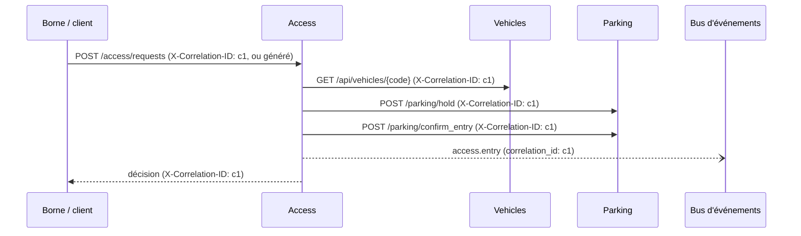

# Access — dossier de revue de code et d'intégration (jalons 10 et 11)

Support de la revue du 24 novembre. Chaque point renvoie au code ou au
README. Les écarts constatés en conditions réelles sont listés en fin de
document, avec leur statut (corrigé / documenté / à traiter avec l'équipe).

---

## 1. Revue de code

### Organisation et séparation des responsabilités

Architecture hexagonale (README [section 4](../README.md#4-architecture-hexagonale)) :

| Couche | Rôle | Dépend de |
|---|---|---|
| `src/domain/` | Entités, règles métier pures, ports (`Protocol`) | rien |
| `src/application/use_cases/` | Orchestration des workflows | `domain` uniquement |
| `src/infrastructure/` | Clients HTTP, SQLite, RabbitMQ, logs, métriques, sécurité | `domain` |
| `src/interfaces/api/` | FastAPI : routes, schémas, middlewares, composition (`deps.py`) | tout |

Vérifiable : aucun `import` de `infrastructure`/`interfaces` dans `domain` ni
`application` (`grep -rn "infrastructure\|interfaces" src/domain src/application`).

### Cohérence code ↔ règles métier

| Règle (document « Règles métier ») | Code | Tests |
|---|---|---|
| Un véhicule déjà présent ne peut pas entrer | `domain/rules/presence_rule.py::can_enter` | `test_presence_rule.py`, `test_access_entry.py` |
| Un véhicule absent ne peut pas sortir | `presence_rule.py::can_exit` | `test_process_exit_request.py` |
| Compatibilité véhicule / place (2 roues, XL, électrique, PMR) | `vehicle_place_compatibility_rule.py` | matrice complète `test_vehicle_place_compatibility_rule.py` |
| Place PMR sans justificatif → confirmation, pas refus | `disability_rule.py` | `test_disability_rule.py` |
| Réservation → place du pool « booking », sinon « walkin » | `ProcessEntryRequest` | `test_process_entry_request.py` |
| Sortie : prix (Pricing) puis paiement (Payment) du stationnement | `ProcessExitRequest` | `test_process_exit_request.py`, `test_http_payment_client.py` |
| Sortie datée avant l'entrée refusée | `stay_rule.py` | `test_stay_rule.py`, `test_quality.py` |
| Access ne voit jamais la plaque (RGPD) | code Vehicles uniquement, `pseudoId` comme `vehicleId` | `test_http_vehicles_client.py` |

### Gestion des erreurs

- Entrées : validation Pydantic → 422 (400 pour une photo non décodable), rien
  n'est persisté ni appelé.
- Services appelés : toute panne (timeout, connexion refusée, 4xx/5xx,
  réponse inattendue) devient une **décision métier propre** (refus motivé
  ou « véhicule inconnu »), jamais une 500 — un seul client y échappait
  (Booking), corrigé en 3.2.0.
- Erreur imprévue : 500 générique sans détail technique, avec `correlationId`
  pour retrouver la stack trace dans les logs.

### Logs, tests, dépendances

- Logs : README [section 9](../README.md#logs-exploitables) — correlation ID,
  une ligne par décision, log d'accès, avertissements des appels sortants.
- Tests : 182 (unitaires + intégration), aucun réseau ; CI en 5 étapes.
- Dépendances (`requirements.txt`) : FastAPI, SQLAlchemy, Pydantic, httpx
  (appels sortants), pika (RabbitMQ), slowapi (rate limiting),
  prometheus-fastapi-instrumentator (métriques). Surveillées par Dependabot et
  `pip-audit` en CI.

### Choix réalisés avec ou sans assistance de l'IA

> À compléter personnellement avant la revue : quelles parties ont été
> conçues seul, lesquelles avec un assistant IA, et ce qui a été vérifié /
> réécrit / refusé dans ses propositions. L'enseignant attend surtout que
> chaque choix ci-dessous puisse être expliqué.

Principaux choix techniques à savoir justifier :

- Architecture hexagonale plutôt qu'un CRUD FastAPI direct (règles testables
  sans réseau, services réels branchés un par un sans toucher au métier).
- SQLite (simplicité, un seul service) — limite : disque éphémère sur Render.
- Publication d'événements **best-effort** après persistance (outbox) : une
  panne du bus ne bloque jamais une barrière.
- Paiement idempotent (clé `access:{stationnement}:exit`) + polling borné.
- Clé API simple plutôt qu'OAuth2 (périmètre du jalon 15).

---

## 2. Revue d'intégration

### Contrats d'API consommés (appels synchrones REST)

Tous les appels passent par `infrastructure/external/outgoing_http.py` :
timeout 20 s, en-tête `X-Correlation-ID`, métriques par service.

| Service | Appel | Données envoyées | Données utilisées | Erreur → comportement d'Access |
|---|---|---|---|---|
| **Vehicles** | `GET /api/vehicles/{code}` | code véhicule | `pseudoId`, `twoWheels`, `xl`, `electric`, `disabled` | non-200 / réseau → « véhicule inconnu » (confirmation requise) |
| **Booking** *(mocké)* | `GET /bookings/active?vehicleId=` *(supposé)* | `vehicleId` pseudonymisé | `id`, `reservedPlaceType`, dates, `placeId` | 404 → pas de réservation ; panne → entrée sans réservation |
| **Parking** | `POST /parking/hold` → `POST /parking/confirm_entry` (avec `hold_id`) ; sortie : `POST /parking/free` — en-tête `X-API-Key` exigé | `category_name`, `commercial_type` (`walkin`/`booking`), `hold_id` | `success`, `hold_id` (place mise de côté 30 s) | `success: false` → « Aucune place disponible » ; panne ou clé refusée → « Service Parking indisponible » ; confirmation refusée (409 expiré/déjà utilisé, 422) → entrée refusée « Place non confirmée par Parking » ; `free` en échec loggé |
| **Pricing** | `POST /quote` | `zone`, `mode`, `duration_min` | `amount_eur` | panne → sortie refusée « tarification indisponible » |
| **Payment** | `POST /payments` puis `GET /payments/{id}` | montant en centimes, clé d'idempotence, référence du stationnement | `payment_id`, `status` | `REFUSED` → refus ; panne / `PENDING` > 40 s → refus « réessayez » (rejouable sans double débit) |

Mappings à valider en revue avec les équipes concernées :

- Catégorie Parking / zone Pricing, même priorité dans les deux clients :
  PMR > 2 roues > électrique > XL > standard.
- Pricing en mode réservation : durée arrondie à l'heure supérieure (≥ 60 min).

### Échanges asynchrones (publiés par Access)

Exchange **`microservice-event-bus`** (CloudAMQP, administré par l'équipe,
déclaré en passif par Access).

| Routing key | Quand | Corps (`payload`) |
|---|---|---|
| `access.entry` | entrée autorisée | `vehicleId`, `placeId`, `placeType`, `reservation` |
| `access.exit` | sortie autorisée | `vehicleId`, `placeId`, `amount`, `paymentId` |
| `access.refused` | refus ou véhicule inconnu | `vehicleId` (ou `null`), `reason` |
| `access.other` | confirmation PMR requise | `vehicleId`, `reason`, place |

Enveloppe commune : `id`, `type` (1 à 4), `requestId`, `payload`,
`createdAt`, `correlationId`. Le correlation ID est aussi dans la propriété
AMQP `correlation_id` et l'en-tête `X-Correlation-ID`. Événements de test :
`scripts/simulate_bus_events.py` (marqués `simulated: true`).

### Workflows réels et correlation ID

Toutes les lignes de log d'Access pour ce passage portent `[cid=c1]`. Pour la
démonstration collective, il suffit que chaque service reprenne l'en-tête
reçu dans ses propres logs.

### Dépendances entre services

Access dépend **en synchrone** de Vehicles (entrée et sortie), Parking
(entrée, et libération à la sortie), Pricing et Payment (sortie). Aucun
service ne dépend d'Access en synchrone : les autres consomment ses
événements. Une panne de l'un d'eux bloque donc le passage concerné, mais
toujours avec un refus explicite et loggé, jamais un plantage.

---

## 3. Écarts constatés et statut

| # | Constat | Statut |
|---|---|---|
| 1 | Booking toujours mocké : contrat (route, codes, champs) non confirmé | 📌 à traiter avec l'équipe Booking — `TODO[BOOKING-*]` dans `http_booking_client.py` |
| 2 | Une panne de Booking (réel) aurait donné une 500 | ✅ corrigé en 3.2.0 (entrée traitée sans réservation) + tests |
| 3 | Vehicles renvoie **500** (et non 404) pour un code inconnu | 📄 contourné (toute non-200 = inconnu) — à remonter à l'équipe Vehicles |
| 4 | Vehicles n'a pas de justificatif PMR distinct : `disabled` sert de type et de justificatif → la confirmation PMR n'arrive jamais avec le vrai service | 📄 documenté (README section 16) — responsabilité à clarifier |
| 5 | Parking ne gère pas d'identifiant de place : `placeId` synthétique `CATEGORIE:walkin\|booking` | 📄 documenté, conforme aux consignes (places comptées par catégorie) |
| 6 | 18/11 : service Parking injoignable (aucune réponse en 75 s) → toutes les entrées refusées « Aucune place disponible », motif trompeur | ✅ corrigé en 3.4.0 : motif distinct « Service Parking indisponible, réessayez plus tard » |
| 7 | 18/11 : variables du `render.yaml` non appliquées par un déploiement automatique (Access appelait `localhost` pour Vehicles) | ✅ résolu par redéploiement ; détectable désormais par le smoke test |
| 8 | Payment n'active pas encore son authentification (`auth_enabled: false`) | 📄 Access envoie déjà `X-API-Key` si `PAYMENT_API_KEY` est renseignée |
| 10 | 18/11 : Parking a activé son authentification (`X-API-Key`) sans prévenir → appels d'Access refusés | ✅ Access envoie `PARKING_API_KEY` (3.4.0) ; 📌 clé à obtenir de l'équipe Parking et à saisir dans Render |
| 11 | 18/11 : `confirm_entry` exige le `hold_id` du `hold` (place mise de côté 30 s) | ✅ géré en 3.5.0 ; entrée refusée si la confirmation échoue |
| 12 | **Sécurité Parking** : la clé API de Parking est écrite en clair dans sa page publique `/dashboard` (lisible par tous dans le code source) | 📌 à signaler à l'équipe Parking — Access ne l'utilise pas et attend sa propre clé |
| 13 | La doc de Parking indique qu'il **consomme aussi les événements RabbitMQ** pour les confirmations d'entrée/sortie : si Parking confirme à partir de `access.entry` en plus de l'appel `confirm_entry` d'Access, une entrée pourrait être comptée deux fois | 📌 à clarifier avec l'équipe Parking (un seul des deux mécanismes) |
| 9 | Propagation du correlation ID par les autres services | 📌 à vérifier en revue d'intégration (Access le transmet partout) |
