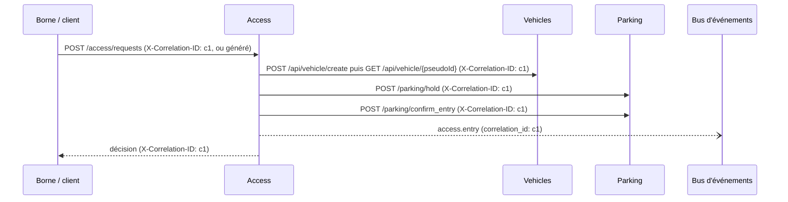

# Access — dossier de revue de code et d'intégration (jalons 10 et 11)

Support de la revue du 24 novembre. Chaque point renvoie au code ou au
README. Les écarts constatés en conditions réelles sont listés en fin de
document, avec leur statut (corrigé / documenté / à traiter avec l'équipe).

---

## 1. Revue de code

### Organisation et séparation des responsabilités

Architecture hexagonale (README [section 4](../README.md#4-architecture-hexagonale)) :

| Couche | Rôle | Dépend de |
|---|---|---|
| `src/domain/` | Entités, règles métier pures, ports (`Protocol`) | rien |
| `src/application/use_cases/` | Orchestration des workflows | `domain` uniquement |
| `src/infrastructure/` | Clients HTTP, SQLite, RabbitMQ, logs, métriques, sécurité | `domain` |
| `src/interfaces/api/` | FastAPI : routes, schémas, middlewares, composition (`deps.py`) | tout |

Vérifiable : aucun `import` de `infrastructure`/`interfaces` dans `domain` ni
`application` (`grep -rn "infrastructure\|interfaces" src/domain src/application`).

### Cohérence code ↔ règles métier

| Règle (document « Règles métier ») | Code | Tests |
|---|---|---|
| Un véhicule déjà présent ne peut pas entrer | `domain/rules/presence_rule.py::can_enter` | `test_presence_rule.py`, `test_access_entry.py` |
| Un véhicule absent ne peut pas sortir | `presence_rule.py::can_exit` | `test_process_exit_request.py` |
| Compatibilité véhicule / place (2 roues, XL, électrique, PMR) | `vehicle_place_compatibility_rule.py` | matrice complète `test_vehicle_place_compatibility_rule.py` |
| Place PMR sans justificatif → confirmation, pas refus | `disability_rule.py` | `test_disability_rule.py` |
| Réservation → place du pool « booking », sinon « walkin » | `ProcessEntryRequest` | `test_process_entry_request.py` |
| Sortie : prix (Pricing) puis paiement (Payment) du stationnement | `ProcessExitRequest` | `test_process_exit_request.py`, `test_http_payment_client.py` |
| Sortie datée avant l'entrée refusée | `stay_rule.py` | `test_stay_rule.py`, `test_quality.py` |
| Durée plafonnée à 7 jours, tout quart d'heure entamé dû (règles 2.4 et 2.5) | `http_pricing_client.py::_duration_minutes` (minute supérieure, 1 min à 7 jours ; le calcul par quart d'heure est fait par Pricing) | `test_http_pricing_client.py` |
| La plaque ne fait que traverser Access (RGPD) | transmise à Vehicles puis oubliée ; seul le `pseudoId` est stocké, publié, renvoyé ; erreurs 422 sans la valeur reçue | `test_no_plate_leak.py` (réponses, base, événements, logs), `test_http_vehicles_client.py` |

### Gestion des erreurs

- Entrées : validation Pydantic → 422 (400 pour une photo non décodable), rien
  n'est persisté ni appelé.
- Services appelés : toute panne (timeout, connexion refusée, 4xx/5xx,
  réponse inattendue) devient une **décision métier propre** (refus motivé
  ou « véhicule inconnu »), jamais une 500 — un seul client y échappait
  (Booking), corrigé en 3.2.0.
- Erreur imprévue : 500 générique sans détail technique, avec `correlationId`
  pour retrouver la stack trace dans les logs.

### Logs, tests, dépendances

- Logs : README [section 9](../README.md#logs-exploitables) — correlation ID,
  une ligne par décision, log d'accès, avertissements des appels sortants.
- Tests : 457 (unitaires + intégration ; clés étrangères appliquées en SQLite comme en Postgres ; suite d'intégration validée aussi contre la base Neon de production, dans un schéma jetable), aucun réseau ; CI en 5 étapes.
- Dépendances (`requirements.txt`) : FastAPI, SQLAlchemy, Pydantic, httpx
  (appels sortants), pika (RabbitMQ), slowapi (rate limiting),
  prometheus-fastapi-instrumentator (métriques). Surveillées par Dependabot et
  `pip-audit` en CI.

### Choix réalisés avec ou sans assistance de l'IA

> À compléter personnellement avant la revue : quelles parties ont été
> conçues seul, lesquelles avec un assistant IA, et ce qui a été vérifié /
> réécrit / refusé dans ses propositions. L'enseignant attend surtout que
> chaque choix ci-dessous puisse être expliqué.

Principaux choix techniques à savoir justifier :

- Architecture hexagonale plutôt qu'un CRUD FastAPI direct (règles testables
  sans réseau, services réels branchés un par un sans toucher au métier).
- Postgres (Neon) en production depuis 3.6.0, SQLite en local et dans les
  tests : le disque de Render est éphémère, la base effaçait tout à chaque
  redémarrage.
- Publication d'événements **best-effort** après persistance (outbox) : une
  panne du bus ne bloque jamais une barrière.
- Paiement idempotent (clé `access:{stationnement}:exit`) + polling borné.
- Clé API simple plutôt qu'OAuth2 (périmètre du jalon 15), avec une **clé
  borne séparée** (4.1.0) : la borne client est un écran public, sa clé
  n'ouvre que le passage d'un véhicule (401 partout ailleurs), jamais
  l'historique ni les présences. Mise en service d'un clic depuis le
  dashboard (4.4.0) : seul l'exploitant (clé d'exploitation) peut obtenir la
  clé borne, rangée dans le navigateur pour la borne ; jamais servie à une
  page publique.
- **Borne publique** (4.5.0) : le lien `/borne` devait marcher pour tous,
  sans réglage. Une page publique ne pouvant pas cacher de clé, plutôt que
  de publier la clé borne (qui ouvrirait `POST /access/requests` en
  entier), une route publique dédiée ne fait que le passage : date imposée
  par le serveur, source forcée, réponse sans identifiants, 10/min par
  adresse. Contrepartie assumée pour la démo, réversible par
  `BORNE_PUBLIC=false`.
- La plaque ne fait que traverser Access (4.0.0) : transmise à Vehicles puis
  oubliée, jamais stockée, publiée, renvoyée ni loggée (test dédié).
- Borne client (`/borne`) servie par Access lui-même : pas de front séparé à
  déployer, pas de CORS ; champs de ticket ajoutés à la réponse sans en
  modifier aucun (aucun consommateur cassé).

---

## 2. Revue d'intégration

### Contrats d'API consommés (appels synchrones REST)

Tous les appels passent par `infrastructure/external/outgoing_http.py` :
timeout 45 s (`COLD_START_TIMEOUT_S`, réveil des services sur l'offre gratuite de Render), en-tête `X-Correlation-ID`, métriques par service.

| Service | Appel | Données envoyées | Données utilisées | Erreur → comportement d'Access |
|---|---|---|---|---|
| **Vehicles** | `POST /api/vehicle/create` (plaque → pseudoId, création si inconnue) puis `GET /api/vehicle/{pseudoId}` (retrouvées automatiquement dans son Swagger s'il les renomme ; routes réglables : `VEHICLES_IDENTIFY_PATH`, `VEHICLES_LOOKUP_PATH`) | plaque normalisée (SIV `AB-123-CD` ; ancien format et étrangères sans séparateurs, ex. `BMW1234`) | `pseudoId`, `twoWheels`, `xl`, `electric`, `disabled` | plaque inconnue → véhicule créé par `identify` (4 roues standard ; à la sortie aussi, Vehicles n'offrant plus de consultation sans création, puis refus « non présent ») ; 5xx, réseau ou 404 sur `identify` → « véhicule non identifié » (confirmation requise), 404 sur `identify` loggé en ERREUR |
| **Booking** (0.4.0) | `GET /reservations/active?vehicle_id=…&at=…` (instant du passage) | `vehicle_id` pseudonymisé, instant UTC | `valid`, `reservations[].id` (code à 6 chiffres), `place_type`, `start_at`, `end_at` | toujours 200 (`valid: false` = pas de réservation) ; panne ou réponse inattendue → entrée sans réservation, jamais d'erreur 500 |
| **Parking** (1.5.0) | `GET /parking/categories` (en cache 5 min) puis `POST /parking/hold` → `POST /parking/confirm_entry` (avec `hold_id`) ; sortie : `POST /parking/free` ; exploitation : `GET /parking/occupation` — en-tête `X-API-Key` exigé | `category_name`, `commercial_type` (`walkin`/`booking`), `hold_id` | `success`, `hold_id` (place mise de côté 30 s), `label` ; occupation : `spot_taken`, `spot_held`, `total_capacity` | catégorie absente de la liste ou 404 sur `hold` → « Catégorie de place X inconnue du service Parking » ; liste indisponible → vérification sautée (n'empêche jamais une entrée) ; `success: false` → « Aucune place disponible » ; panne ou clé refusée → « Service Parking indisponible » ; confirmation refusée (409 expiré/déjà utilisé, 422) → entrée refusée « Place non confirmée par Parking » ; `free` en échec loggé |
| **Pricing** | `POST /quote` (Pricing calcule seul le montant) | `zone` (`standard`, `xl`, `handicapped`, `electric`, `two_wheels`), `mode`, `duration_min` | `amount_eur` | panne → sortie refusée « tarification indisponible » |
| **Payment** | `POST /payments` puis `GET /payments/{id}` | montant en centimes, clé d'idempotence, référence du stationnement | `payment_id`, `status` | `REFUSED` → refus ; panne / `PENDING` > 40 s → refus « réessayez » (rejouable sans double débit) |

Mappings à valider en revue avec les équipes concernées :

- Catégorie Parking / zone Pricing, même priorité dans les deux clients :
  PMR > 2 roues > électrique > XL > standard.
- Pricing en mode réservation : durée arrondie à l'heure supérieure (≥ 60 min).

### Échanges asynchrones (publiés par Access)

Exchange **`microservice-event-bus`** (CloudAMQP, administré par l'équipe,
déclaré en passif par Access).

| Routing key | Quand | Corps (`payload`) |
|---|---|---|
| `access.entry` | entrée autorisée | `vehicleId`, `placeId`, `placeType`, `reservation` |
| `access.exit` | sortie autorisée | `vehicleId`, `placeId`, `amount`, `paymentId`, `enteredAt` (heure d'entrée, UTC), `durationMinutes` (durée réelle, minutes entamées) |
| `access.refused` | refus ou véhicule inconnu | `vehicleId` (ou `null`), `reason` |
| `access.other` | confirmation PMR requise | `vehicleId`, `reason`, place |

Enveloppe commune : `id`, `type` (1 à 4), `requestId`, `payload`,
`createdAt`, `correlationId`. Le correlation ID est aussi dans la propriété
AMQP `correlation_id` et l'en-tête `X-Correlation-ID`. Événements de test :
`scripts/simulate_bus_events.py` (marqués `simulated: true`).

### Workflows réels et correlation ID

Toutes les lignes de log d'Access pour ce passage portent `[cid=c1]`. Pour la
démonstration collective, il suffit que chaque service reprenne l'en-tête
reçu dans ses propres logs.

### Dépendances entre services

Access dépend **en synchrone** de Vehicles (entrée et sortie), Parking
(entrée, et libération à la sortie), Pricing et Payment (sortie). Aucun
service ne dépend d'Access en synchrone : les autres consomment ses
événements. Une panne de l'un d'eux bloque donc le passage concerné, mais
toujours avec un refus explicite et loggé, jamais un plantage.

---

## 3. Écarts constatés et statut

| # | Constat | Statut |
|---|---|---|
| 1 | Booking était mocké : contrat (route, codes, champs) non confirmé | ✅ 4.6.0 : Booking réel (`GET /reservations/active`), contrat lu sur son Swagger et vérifié en réel (cas « pas de réservation ») |
| 2 | Une panne de Booking (réel) aurait donné une 500 | ✅ corrigé en 3.2.0 (entrée traitée sans réservation) + tests |
| 3 | Vehicles renvoyait **500** (et non 404) pour un code inconnu | ✅ corrigé par Vehicles (24/11) : 404 pour une plaque inconnue, qu'Access distingue désormais d'une panne |
| 4 | Vehicles n'a pas de justificatif PMR distinct : `disabled` sert de type et de justificatif → la confirmation PMR n'arrive jamais avec le vrai service | 📄 documenté (README section 16) — responsabilité à clarifier |
| 5 | Parking ne gère pas d'identifiant de place : `placeId` synthétique `CATEGORIE:walkin\|booking` | 📄 documenté, conforme aux consignes (places comptées par catégorie) |
| 6 | 18/11 : service Parking injoignable (aucune réponse en 75 s) → toutes les entrées refusées « Aucune place disponible », motif trompeur | ✅ corrigé en 3.4.0 : motif distinct « Service Parking indisponible, réessayez plus tard » |
| 7 | 18/11 : variables du `render.yaml` non appliquées par un déploiement automatique (Access appelait `localhost` pour Vehicles) | ✅ résolu par redéploiement ; détectable désormais par le smoke test |
| 8 | Payment n'active pas encore son authentification (`auth_enabled: false`) | 📄 Access envoie déjà `X-API-Key` si `PAYMENT_API_KEY` est renseignée |
| 10 | 18/11 : Parking a activé son authentification (`X-API-Key`) sans prévenir → appels d'Access refusés | ✅ Access envoie `PARKING_API_KEY` (3.4.0) ; clé obtenue et saisie dans Render |
| 11 | 18/11 : `confirm_entry` exige le `hold_id` du `hold` (place mise de côté 30 s) | ✅ géré en 3.5.0 ; entrée refusée si la confirmation échoue |
| 12 | **Sécurité Parking** : la clé API de Parking était écrite en clair dans sa page publique `/dashboard` | ✅ vérifié le 24/11 : la page demande désormais la clé à l'utilisateur (`prompt`, gardée en `sessionStorage`), plus aucune clé dans le code source |
| 13 | La doc de Parking indique qu'il **consomme aussi les événements RabbitMQ** pour les confirmations d'entrée/sortie : si Parking confirme à partir de `access.entry` en plus de l'appel `confirm_entry` d'Access, une entrée pourrait être comptée deux fois | 📌 à clarifier avec l'équipe Parking (un seul des deux mécanismes) |
| 14 | **Vehicles ne respectait pas la règle 3.2** (« Vehicles *recherche ou crée* l'identifiant pseudonymisé ») : `identify` exigeait un code fourni par l'appelant et renvoyait 500 pour une plaque connue | ✅ corrigé par Vehicles (24/11) : `identify` retrouve ou crée (même `pseudoId` pour une même plaque, vérifié par appels réels) ; Access l'appelle à l'entrée pour une plaque inconnue (4.0.0) |
| 15 | Durée envoyée à Pricing : 0 min (sortie juste après l'entrée) et plus de 7 jours refusés par Pricing (422) → sortie bloquée ; règle 2.4 (« durée plafonnée à sept jours ») non appliquée | ✅ corrigé en 3.5.1 : durée arrondie à la minute supérieure, bornée entre 1 min et 7 jours |
| 16 | Le cas « véhicule inconnu → intervention d'un agent » vient de la spec d'Access, pas des règles métier, qui mettent le « traitement manuel des erreurs » hors périmètre (section 5) | 📄 depuis 4.0.0, ne reste possible qu'en cas de panne de Vehicles (entrée) ou de plaque jamais entrée (sortie) : refus sûr, barrière fermée |
| 17 | 18/11 : SQLite sur le disque éphémère de Render → base effacée à chaque redéploiement ou réveil (constaté : 4 passages perdus en quelques minutes). Un véhicule garé pendant une mise en veille ne pouvait plus sortir | ✅ 3.6.0 : Postgres Neon en production (`DATABASE_URL`), tables créées au démarrage. Corrigé au passage : la présence était enregistrée avant la demande d'entrée qu'elle référence (clé étrangère), ce qui aurait fait échouer chaque entrée sous Postgres |
| 18 | 24/11 : **nouveau contrat Vehicles**, sans prévenir : plus de `code`, consultation par plaque (`GET /api/vehicles/{plaque}`). Access envoyait un code → tous les véhicules auraient été « inconnus » | ✅ 4.0.0 : Access reçoit la plaque (`licensePlate`), la transmet à Vehicles sans la conserver, vérification déplacée en `POST /access/vehicles/known` (plaque hors des URL) ; testé contre le vrai service. 📌 à signaler à Vehicles : la plaque figure dans l'URL de `GET /api/vehicles/{plaque}`, donc dans les journaux de leur hébergeur |
| 19 | 24/11 : **Parking 1.5.0** : `GET /parking/categories`, `label` dans ses réponses, `spot_held` dans l'occupation (champs uniquement ajoutés, rien de cassé) | ✅ 4.2.0 : catégories vérifiées avant chaque `hold` (motif précis si Parking renomme une catégorie), libellés affichés (borne, dashboard), occupation par catégorie dans le dashboard (`GET /access/parking`). Contrat lu sur le Swagger de Parking : leurs routes exigent la clé Parking, non disponible en local, donc à revérifier en ligne après déploiement |
| 20 | Borne et API n'acceptaient que les plaques françaises SIV (`AB-123-CD`) : ancien format français et plaques étrangères refusés | ✅ 4.3.0 : 2 à 10 lettres ou chiffres, séparateurs acceptés ; SIV gardée en `AB-123-CD` (véhicules déjà connus de Vehicles retrouvés), autres plaques sans séparateurs pour qu'une même plaque donne toujours le même véhicule. 📄 Le filtre de logs ne masque que le format SIV : les autres formats ne sont jamais loggés par le code (test anti-fuite étendu aux plaques étrangères) |
| 21 | Le lien de la borne envoyé à l'équipe affichait « Borne hors service » : chacun devait saisir la clé (`?config`) | ✅ 4.5.0 : borne publique (`POST /borne/passages`, sans clé, limitée au passage) ; le lien marche tel quel. 📄 Le débit de `POST /access/requests` (20/min) était compté sur l'adresse du proxy de Render, donc partagé par tous ; la route publique compte, elle, par adresse réelle |
| 22 | 24/11 (après-midi) : **Vehicles renomme ses routes** sans prévenir (`/api/vehicles/{plaque}` → `/api/getvehicles/{plaque}`, `/api/vehicles/identify` → `/api/identify`). Toutes les plaques passaient « inconnues » et aucune n'était créée (« Un agent arrive ») | ✅ 4.5.1 : nouvelles routes, testées en réel (création, même identifiant au 2e passage) ; routes désormais réglables dans Render sans toucher au code ; un 404 sur `identify` est loggé en ERREUR (« contrat changé ? »). 📌 à remonter à l'équipe Vehicles : prévenir avant de renommer une route |
| 23 | Réservation **payée d'avance** à Booking, alors qu'Access recalculait un prix « réservé » à la sortie : le client aurait payé deux fois | ✅ 4.6.0 : rien à payer dans le créneau, seul le dépassement après la fin est facturé (tarif sans réservation). 📌 règle de dépassement à valider avec Booking et Pricing. **Constaté le 24/11 dans la doc et en réel** : Pricing n'a aucune notion de dépassement et applique sa gratuité initiale (`free_period_min` = 60 min) à tout devis `walk_in` ; un dépassement de moins d'une heure est donc gratuit, et 90 min de dépassement ne sont facturées que 30 min. À trancher avec Pricing : accepter, ou faire ajouter par Pricing un mode « dépassement » sans gratuité (Access enverrait alors ce mode). Une réservation réelle n'a pas été créée pour le test en ligne (elle déclencherait un vrai paiement) : le cas « réservation valable » est couvert par les tests sur le format documenté |
| 24 | 24/11 (soir) : **3ᵉ changement de contrat Vehicles** : `GET /api/getvehicles/{…}` attend désormais l'identifiant (UUID), plus la plaque (400). Aucune nouvelle plaque n'était identifiée (« Un agent arrive ») | ✅ 4.6.1 : plaque → `POST /api/identify` → pseudoId → `GET /api/getvehicles/{pseudoId}` ; vérifié en réel (véhicule connu jamais réécrit : PMR et électrique conservés). 📄 plus de consultation sans création : une plaque inconnue à la sortie est enregistrée par Vehicles, sans effet pour Access. 📌 3 changements non annoncés en une journée : demander à l'équipe Vehicles de figer son contrat |
| 25 | Borne : le type de véhicule n'était pas demandé (tout nouveau véhicule créé « standard ») et le libellé technique de Parking (« HANDICAPPED ») pouvait s'afficher au client | ✅ 4.7.0 : écran « Votre véhicule » à l'entrée (5 types, icônes, libellés français) ; type transmis à Vehicles pour créer un véhicule inconnu (un véhicule connu n'est jamais modifié, vérifié en réel) ; PMR déclaré mais inconnu de Vehicles → agent (jamais enregistré sur déclaration) ; libellés de place toujours en français |
| 26 | **Collision de plaques entre pays** : l'Italie utilise le même format que la France (`AB 123 CD`) ; deux véhicules différents auraient eu la même identité chez Vehicles (l'un « sortant » à la place de l'autre, ou l'autre refusé « déjà présent ») | ✅ 4.8.0 : pays demandé à la borne (France par défaut), identité `<ISO>:<plaque>` pour les plaques étrangères (vérifié en réel : identités distinctes et stables chez Vehicles), format vérifié par pays. 📌 convention `<ISO>:<plaque>` à partager avec Vehicles et Booking (une réservation faite chez Booking pour une plaque étrangère sans pays ne serait pas retrouvée) ; idéalement, un champ `country` chez Vehicles |
| 27 | Test en ligne du 24/11 : une sortie de deux-roues refusée « non présent » juste après son entrée, non reproduite ensuite (5 rejeux OK) | 📄 cause probable : identité changée chez Vehicles entre l'entrée et la sortie (service redéployé plusieurs fois ce jour-là, stockage déjà signalé non persistant au point 14). Access ne peut pas s'en prémunir sans conserver la plaque (RGPD). 📌 à remonter à Vehicles : identité stable dans le temps |
| 28 | 24/11 (soir) : Vehicles ajoute `GET /api/getplate/{vehicleId}` (devenue `GET /api/vehicles/{vehicleId}/plate` au contrat 4, puis `GET /api/vehicle/{vehicleId}/plate` au contrat 5, toujours sans clé ; vérifié), qui redonne la plaque en clair à partir de l'identifiant. **Besoin légitime** (confirmé par l'équipe) : retrouver vite la plaque pour éditer une facture ou un reçu, et c'est bien à Vehicles de la détenir. Seul problème : la route est **ouverte sans aucune clé** (vérifié), alors que l'identifiant pseudonymisé circule dans tous les événements du bus et dans l'historique d'Access : n'importe qui peut donc retrouver la plaque | 📌 **à remonter à l'équipe Vehicles (RGPD)** : garder la route, mais la protéger par une clé (`X-API-Key`, comme Parking) remise aux seuls services qui éditent les factures ; elle reste aussi rapide pour eux. Côté Access : jamais appelée (Access n'en a pas besoin) ; la borne publique ne renvoie pas l'identifiant. Le reste du contrat (`identify`, `getvehicles`) est inchangé et compatible (`licensePlate` obligatoire, caractéristiques à `false` par défaut) |
| 29 | 24/11 (soir) : **4ᵉ changement de contrat Vehicles** : `POST /api/identify` → `POST /api/vehicles/create`, `GET /api/getvehicles/{id}` → `GET /api/vehicles/{id}`, champ `disabled` → `handicaped`. L'ancienne route répondait 404 : chaque entrée à la borne finissait en « Un agent va arriver », aucun véhicule n'était créé | ✅ 4.8.1 : nouvelles routes par défaut, les deux noms du champ PMR acceptés ; vérifié en réel (création, même identifiant au passage suivant, véhicule connu jamais réécrit, PMR jamais envoyé sur simple déclaration). Le 404 avait bien été loggé en ERREUR, comme prévu. 📌 **à remonter à l'équipe Vehicles** : 4 contrats en une journée, chaque fois sans prévenir, et chaque fois la borne tombe ; demander un contrat figé (ou versionné, `/api/v2/...`) et une annonce avant tout renommage. Nouveau détail : `create` compare la plaque telle quelle (casse et espaces comptent) ; sans effet pour Access, qui envoie toujours la forme normalisée |
| 30 | 24/11 (soir) : **5ᵉ changement de contrat Vehicles**, une heure après le 4ᵉ : `/api/vehicles/...` → `/api/vehicle/...` (singulier). La borne est retombée en « Un agent va arriver » pendant la démonstration en classe | ✅ 4.9.0 : nouvelles routes par défaut et surtout **découverte automatique** : sur un 404, Access lit le Swagger de Vehicles (`/v3/api-docs`), y retrouve la création (POST avec `licensePlate`) et la consultation (GET dont la réponse contient `pseudoId`, jamais la route `/plate`), réessaie aussitôt et garde ces routes (avertissement dans les logs, au plus une lecture par minute). Vérifié en réel en partant des routes du contrat 4 : même véhicule retrouvé, caractéristiques conservées. Limite : si Vehicles change aussi le corps ou la réponse (pas seulement les routes), la découverte échoue et le 404 reste loggé en ERREUR. 📌 à remonter : contrat figé ou versionné, annonce avant tout changement |
| 31 | 24/11 : **Pricing publie sa grille v2** (10 h 29) et renomme la zone PMR `disabled` → `handicapped`. Access envoyait encore `disabled` → 404 `ZONE_NOT_FOUND` → **toute sortie d'un véhicule PMR refusée** (« service de tarification indisponible »), sans paiement ni barrière ouverte | ✅ 4.9.1 : zone `handicapped` envoyée ; sur un `ZONE_NOT_FOUND`, l'ancien nom est réessayé (si Pricing revenait en arrière). Vérifié en réel sur les 5 zones (90 min : standard 1,50 €, PMR 0,75 €, deux-roues 0,50 €, électrique 1,75 €, XL 2,25 €). 📌 à remonter : prévenir avant de renommer une zone |
| 32 | 24/11 (soir) : **revue des 5 API de l'équipe** (Swagger relus, champs comparés à ce qu'Access envoie et lit, appels réels en lecture seule). Booking 0.4.0, Parking 1.5.0 et Payment 0.1.0 inchangés et compatibles ; Vehicles et Pricing corrigés (points 30 et 31). **Payment** : `auth_enabled: false`, et `GET /payments` liste tous les paiements **sans aucune clé** (montants, références des stationnements) | ✅ Access compatible avec les 5 services, vérifié en réel en 4.9.1 (batterie en ligne 59/59, plus une entrée et une sortie PMR de bout en bout). Access envoie déjà sa clé à Payment (`PAYMENT_API_KEY`). 📌 **à remonter à l'équipe Payment** : activer l'authentification (`auth_enabled`) pour que la liste des paiements ne soit plus publique |
| 33 | 24/11 (après-midi) : **6ᵉ changement Vehicles** : la réponse de `GET /api/vehicle/{id}` renomme ses champs (`electric` → `isElectric`, `xl` → `isXl`, `twoWheels` → `isTwoWheels`, `handicaped` → `isHandicaped`). Access ne les trouvait plus : **tout véhicule était lu comme une voiture standard** (un PMR, un XL ou un deux-roues connu perdait son type, sans aucune erreur visible). Vehicles ajoute aussi `GET /api/vehicles` (liste de tous les véhicules, sans plaque, sans clé) | ✅ 4.9.2 : chaque caractéristique lue sous tous ses noms connus ; vérifié en réel (XL + électrique, PMR, deux-roues). 📌 à remonter à l'équipe Vehicles : 6 changements en une journée ; un renommage de champ ne se détecte pas par un 404, il passe silencieusement |
| 34 | Borne : un conducteur PMR inconnu comme tel de Vehicles restait bloqué sur « Un agent arrive » ; aucune route ne permettait à l'agent de valider | ✅ 4.10.0 : bouton « Validation agent » sur la borne, code agent (`AGENT_CODE`, `123` pour la démonstration), `POST /borne/pmr-validation` : justificatif enregistré chez Vehicles (`PUT /api/vehicle/{id}` avec `isHandicaped`, seul champ modifié, vérifié), puis entrée rejouée sur place PMR ; plus besoin d'agent ensuite. Sans carte : entrée sur place standard. 📄 code simple assumé (démonstration, pas d'agent réel) : 10 essais par minute et par adresse ; en production, un code par agent ou une validation depuis un poste authentifié. Lecture de la carte par IA envisagée, hors périmètre |
| 35 | 24/11 (14 h 30) : **Vehicles redéploie avec Spring Security** : `PUT` et `DELETE` répondent 403, `GET /api/vehicles` 401 ; création et consultation restent ouvertes, **et `GET /api/vehicle/{id}/plate` aussi** (la plaque reste lisible sans clé). Pendant le redéploiement, Vehicles ne répondait plus : toute entrée finissait en « Un agent arrive ». Le mode d'authentification attendu n'est pas documenté dans son Swagger | ✅ 4.10.1 : la validation PMR par l'agent ne bloque plus si Vehicles refuse l'enregistrement (entrée PMR pour ce passage, sans mémorisation, avertissement dans les logs) ; délai d'attente de Vehicles porté à 45 s (réveil d'un service gratuit de Render : 30 à 50 s). 📌 **à demander à l'équipe Vehicles** : la clé et l'en-tête attendus pour `PUT` (Access envoie `X-API-Key` dès que `VEHICLES_API_KEY` est renseignée dans Render), et protéger aussi la route `/plate` (point 28) |
| 36 | 24/11 (16 h) : l'équipe Vehicles annonce que la création renverra **201** au lieu de 200 (encore 200 au moment du contrôle). Access n'acceptait que 200 : au changement, toute entrée serait repartie en « Un agent arrive ». Vehicles ajoute aussi `GET /api/vehicles/with-plate` (liste avec les plaques) et `/api/users` : **protégées (401)**, vérifié sans lire leur contenu ; `GET /api/vehicle/{id}/plate` reste, elle, ouverte sans clé | ✅ 4.10.2 : 200 et 201 acceptés à la création, 200 et 204 à l'enregistrement PMR. Access n'appelle aucune des routes qui renvoient une plaque. 📌 rappel à l'équipe Vehicles : protéger aussi `/plate` (point 28) |
| 37 | L'occupation du parking n'était lisible qu'en liste (taux par catégorie) : difficile à présenter et à suivre d'un coup d'œil pendant une démonstration | ✅ 4.11.0 : onglet « Plan 3D » du dashboard (three.js) : une zone par catégorie de Parking, un véhicule du bon type par place prise, entrées et sorties animées quand l'occupation change, jour et nuit selon le thème. Mêmes données que l'onglet « État du parking » (`GET /access/parking`), aucune nouvelle route, aucune plaque. three.js est une copie figée servie par Access (empreinte contrôlée en CI), pas un CDN. 📄 Parking ne donne que des compteurs par catégorie, pas de numéro de place : la position de chaque véhicule dans sa zone est donc choisie par le plan, pas par Parking |
| 38 | Le plan 3D n'était visible que de l'exploitant (dashboard, clé requise) : les clients et le reste de l'équipe ne le voyaient pas | ✅ 4.12.0 : dock sur la borne publique (borne / parking en direct) ; le plan 3D s'ouvre en plein écran pour tout le monde. Nouvelle route publique `GET /borne/parking` : compteurs par catégorie seulement, aucun véhicule ni identifiant ; réponse de Parking gardée 10 s et débit limité par adresse, pour ne pas faire porter les visiteurs sur Parking (offre gratuite de Render). 📄 choix assumé : l'occupation d'un parking n'est pas une donnée personnelle (elle se voit sur place) ; `BORNE_PUBLIC=false` ferme aussi cette route |
| 39 | « Service Parking indisponible, réessayez plus tard » revenait souvent. **Deux causes.** (a) **Catégorie pleine** : le 24/11 à 15 h 40, XL (12/12) et deux-roues (10/10) étaient complets chez Parking (remplis notamment depuis les boutons de test de son propre tableau de bord) ; Parking refuse alors le `hold` par une erreur HTTP, qu'Access traduisait par « indisponible » au lieu de « complet ». (b) Au premier passage après une pause. Parking n'était pas en panne : les cinq services sont sur l'offre gratuite de Render, endormis après 15 min sans trafic, et leur réveil prend 30 à 60 s alors qu'Access n'attendait que 20 s (Parking, Booking, Pricing, Payment). Contrôlé : aucune limite de débit en cause (lectures répétées, toutes réussies) | ✅ 4.12.1 : (0) hold refusé (4xx hors 401/403/404/429) : Access demande à Parking `GET /parking/availability/{catégorie}/{type}` ; s'il répond « plus de place », la borne affiche « Le parking est complet » ; sinon, c'est bien une panne ; (1) Access **réveille les cinq services d'avance** (`GET /health`, en parallèle, sans attendre) à son propre démarrage et à l'ouverture de la borne ou du dashboard, au plus une fois toutes les 4 min : le temps de choisir son véhicule et de saisir sa plaque, ils sont prêts, et ils restent éveillés tant qu'une page d'Access est ouverte ; (2) délai d'attente porté à 45 s pour les cinq services. `WARM_UP_SERVICES=false` coupe les réveils. 📄 limite : si un service met plus de 45 s à se réveiller et que personne n'a ouvert la page avant, le premier passage peut encore être refusé ; le suivant passe. Un hébergement payant (sans mise en veille) supprimerait le problème |
| 40 | Réservations : rien ne les montrait dans le plan 3D. Et une réservation ne bloque pas toujours une place : le 24/11 à 15 h 40, Booking vendait encore **2 places XL pour l'heure en cours** (`GET /availability` : `min_free_capacity` 2) alors que Parking comptait **XL 12/12**. Un client avec réservation serait alors refusé « Réservation trouvée mais aucune place disponible » | ✅ 4.13.0 : un « R » bleu au-dessus de chaque véhicule entré avec une réservation (plan du dashboard et de la borne), compte dans la légende ; `reserved` par catégorie dans `GET /borne/parking`. Côté Access, le parcours est déjà en place : à l'entrée, réservation vérifiée chez Booking (`/reservations/active`), place demandée à Parking dans le contingent `booking`, rien à payer dans le créneau. 📌 **à régler entre Parking et Booking** : garder réellement les places vendues par Booking (que les entrées sans réservation, `walkin`, ne puissent pas prendre le contingent `booking`). Access ne peut pas le faire seul : Booking n'expose pas le nombre de réservations en cours (seulement les places encore vendables), et Parking ne distingue pas les deux contingents dans son occupation |
| 41 | 25/11 : **test à grande échelle de l'équipe** (116 passages, 14 h 11 – 16 h 55 UTC, bilan par `scripts/bilan_journal.py`) : 77 autorisés ; refus : 10 « Parking indisponible » (catégories pleines, avant 4.12.1), 10 « justificatif PMR requis », 6 « non présent », 5 « non identifié » (Vehicles endormi), 5 « déjà présent », 2 « aucune place », 1 « type incompatible ». **29 véhicules de test restés dans le parking** (XL 11, deux-roues 10…) ; et Parking comptait Standard 80/80 alors qu'Access n'avait que 4 voitures standard : **76 places prises directement depuis le tableau de bord de Parking**, hors Access | 📌 à faire par l'équipe : sortir les véhicules de test (borne, avec leur plaque) et libérer les places prises chez Parking hors Access (son tableau de bord, « Enregistrer la sortie ») ; sinon le parking reste « complet » pour les vrais passages |
| 42 | 25/11 : **revue de sécurité** (agent `securite`) : (a) chaque passage peut attendre 45 s un service endormi et la borne publique n'avait pas de plafond : quelques visiteurs pouvaient occuper les 40 threads d'Access, `/health` compris ; (b) la découverte des routes Vehicles acceptait une « route » `@autre.hote/x` lue dans son Swagger public, qui aurait envoyé la plaque ailleurs ; (c) avec le code agent (`123`, visible dans l'exemple Swagger et dans `render.yaml`), on pouvait faire enregistrer **n'importe quelle plaque** comme PMR chez Vehicles ; (d) le test anti-fuite de plaque ne couvrait pas toute la borne publique | ✅ 4.13.1 : (a) 8 passages simultanés au plus sur la borne publique (`BORNE_MAX_CONCURRENT`), 503 « réessayez » au-delà ; (b) seuls des chemins simples (`/api/…`) sont acceptés depuis le Swagger de Vehicles ; (c) validation PMR acceptée seulement pour un véhicule mis en attente d'agent à l'entrée dans les 5 dernières minutes (409 sinon), exemple Swagger neutre (`0000`) ; (d) test anti-fuite étendu (entrée et sortie à la borne, 422 sur les routes publiques, 403 code agent, traces d'exception). 📄 restent à surveiller : pas de Content-Security-Policy (la clé d'exploitation est dans le `localStorage` du dashboard, même origine que la borne) ; filtre de masquage des logs limité au format `AB-123-CD` (simple filet, aucune fuite constatée) ; mode « par plaque » de Vehicles encore activable par configuration ; vérifier une fois en production que `client_ip` lit bien l'adresse du visiteur. Note : pendant la veille des API, l'agent a envoyé un `POST /api/users` vide chez Vehicles pour vérifier sa protection (403, rien créé) |
| 43 | Plan 3D de la borne : il s'ouvrait de nuit sur un appareil en thème sombre, on ne pouvait que le regarder, et rien n'y montrait où et comment réserver | ✅ 4.14.0 : toujours de jour à l'arrivée ; **mode « Promenade »** (personnage à la troisième personne et son chihuahua, ZQSD, course, manette tactile, collisions avec véhicules garés, haies et mobilier, zone et occupation affichées en marchant) ; **borne de réservation** dans le décor (places réservables chez Booking pour l'heure en cours, véhicules entrés avec une réservation) ; sur la borne publique, la borne d'entrée ou de sortie du décor lance le vrai parcours. `GET /borne/parking` gagne `reservable` (lecture de `GET /availability` de Booking, délai court de 5 s, gardée 60 s). 📄 la borne de réservation informe, elle ne réserve pas : une réservation déclenche un paiement et se fait auprès de Booking |
| 44 | Un véhicule resté « présent » ne pouvait sortir que par la borne, avec sa plaque, qu'Access ne conserve pas : après le test à grande échelle, 29 véhicules de test bloquaient des places (point 41), sans moyen de les sortir | ✅ 4.15.0 : `POST /access/presences/{vehicleId}/release` (clé d'exploitation) et boutons « Libérer » / « Tout libérer » dans le dashboard, avec confirmation. Place rendue à Parking, présence « sorti », sortie tracée avec un motif explicite, événement `VEHICLE_EXITED` marqué `forced: true`, rien de facturé. Si Parking ne rend pas la place, la présence est quand même libérée et c'est signalé. 📄 l'action ne libère que ce qu'Access a fait entrer : les places prises directement depuis le tableau de bord de Parking restent à libérer chez Parking. 📌 à dire aux équipes qui consomment `VEHICLE_EXITED` : `forced: true` = sortie sans paiement |
| 45 | Le plan 3D montrait le parking mais ne donnait aucune raison d'y rester ni d'y revenir : rien à faire une fois le tour fait | ✅ 4.16.0 : saut, **trois véhicules à conduire**, **agent du parking** qui fait sa ronde seul, et **Bonneplace, le village du parking**, aux couleurs d'Access (arche, mascotte, huit commerces, belvédère, Tour Access, fête, champs de fleurs). Trois boutiques où tout est offert (tenue, huit coupes de cheveux, cinq compagnons), **carnet de treize tampons** avec feu d'artifice final, tickets chance, photo souvenir. La borne de réservation du décor affiche d'abord le nombre de places libres à l'instant. Le promeneur démarre toujours sur le parvis du parking. 📄 tenue, compagnon et carnet restent dans le navigateur de l'appareil (deux clés `localStorage`, aucune donnée personnelle, aucun envoi : vérifié par un test) ; le carnet est un jeu et ne promet aucun tarif. 📌 pour convertir un visiteur en client, il manque une page publique de réservation chez Booking vers laquelle la borne du décor pourrait renvoyer |
| 46 | La promenade se faisait seul, les stands ne faisaient que parler, et rien ne donnait envie de revenir : difficile d'en faire un argument face à la concurrence | ✅ 4.17.0 : **promenade multijoueur** (on voit les autres visiteurs, leur compagnon, leur véhicule, un pseudo attribué et leur nombre de succès ; visibles aussi depuis le dashboard), **six mini-jeux** (stands de la fête, grosse caisse, « plein pile »), **Station Access** avec un panneau des places libres en direct et un créneau noté sur 100, **vingt-quatre succès** avec un rang, **ticket d'or** caché chaque jour à un endroit différent, personnage refait (visage, coupes lisibles), dix compagnons. 📄 choix de sécurité pour des routes publiques : aucun texte libre (pseudo attribué par le serveur à partir d'un jeton aléatoire, quatre saluts dans une liste), entrées bornées et validées, jeton jamais renvoyé, rien en base, salon limité à 60 promeneurs, positions oubliées après 12 s, délai d'envoi allongé quand il y a du monde ; le plan n'appelle que ces routes, sans clé ni cookie (tests). 📄 les scores sont déclarés par le navigateur : c'est un jeu, pas un classement officiel, et ils repartent de zéro au redémarrage du service. 📌 le salon vit dans la mémoire d'une seule instance : à revoir (Redis) si Access tourne un jour sur plusieurs instances |
| 47 | Le parking n'avait pas de marque à lui dans le plan 3D, les personnages restaient sommaires, les tenues ne changeaient que de couleur, et rien n'expliquait à un visiteur ce qu'il avait sous les yeux | ✅ 4.18.0 : marque **KingPar** (logo en couronne de traces de pneu, dans Figma et dans `static/kingpar-logo.svg`, posé sur la tour, le panneau des places libres, les ballons, l'accueil) ; **fenêtre d'accueil** à la première visite ; personnages refaits dans un style doux ; **huit tenues**, bas, accessoires et couvre-chefs ; **ballons** ; **covoiturage** entre promeneurs ; mini-jeux et interface redessinés ; trente succès. 📄 les nouveaux champs du multijoueur sont facultatifs et bornés (un ancien client continue de marcher) ; toujours aucun texte libre. 📄 le TP Splunk (`tp/splunk`, `SPLUNK.md`) est rangé à côté du service : image sans mot de passe, interface ouverte sur `127.0.0.1` seulement (tests). 📌 « KingPar » est le nom de la marque dans le plan ; le service, lui, s'appelle toujours Access |
| 48 | Les personnages restaient peu engageants, le décor anguleux tranchait avec eux, et une fois les stands essayés il manquait un fil conducteur | ✅ 4.19.0 : personnages au **style doux** (grosse tête, visage peint qui cligne des yeux, corps en cloche), décor arrondi dans le même esprit, **six quêtes** données par des habitants (« ! », « ? », bulle de dialogue), **onze mini-jeux**, treize coupes, quatre regards, six véhicules, quarante et un succès. 📄 le style reprend un genre (jeux de vie tranquille), pas les personnages d'un jeu existant : formes, visages et habitants sont dessinés pour KingPar. 📄 toujours aucune saisie : les quêtes et les dialogues sont des textes fixes ; la progression (quêtes comprises) reste dans le navigateur. 📌 pour aller plus loin en qualité (personnages sculptés et animés), il faudrait de vrais modèles 3D et leur chargeur, donc des fichiers en plus à servir |
| 49 | On voyait les autres promeneurs sans pouvoir jouer avec eux ; les animaux, les maisons et le sol tranchaient avec les nouveaux personnages ; il manquait une activité de fond | ✅ 4.20.0 : **défis amicaux** à deux (morpion, pierre-feuille-ciseaux, pile ou face) lancés depuis une roulette, **Suppositofarm** (carottes, arbres à abattre à coups de poing, grotte à minerais), animaux, toits et sol repris dans le style doux. 📄 l'arbitrage est côté serveur : coups validés un par un, tour de jeu imposé, pièce tirée par le serveur (`secrets`), choix de l'adversaire masqué jusqu'à la fin, un seul défi à la fois par promeneur, oubli après 90 s (tests unitaires et d'intégration). 📄 toujours aucun texte libre : les défis ne transportent que des identifiants et des entiers bornés. 📌 les récoltes de la ferme restent dans le navigateur ; elles ne s'échangent pas entre joueurs |
| 50 | Décor encore inégal (toits, ferme, grotte), monde plat, peu de sons, défis sans mise en scène | ✅ 4.21.0 et 4.22.0 : maisons de village (toits à deux pans en tuiles, pignons, portes arrondies, haies), **Kingfarm** agrandie, **grotte** de pierre dont la voûte s'efface à l'entrée, **monde courbé** en promenade, **sons** des gestes, voix et musique avec réglages, animations des défis. 📄 le monde courbé est un effet du nuanceur : positions réelles, collisions, ombres et vue de haut restent à plat, donc le survol des places n'est pas faussé. 📄 tous les sons sont synthétisés par le navigateur : aucun fichier téléchargé, aucune œuvre protégée reprise. 📌 des sons enregistrés demanderaient une source libre (CC0) choisie et versée au dépôt |
| 9 | Propagation du correlation ID par les autres services | 📌 à vérifier en revue d'intégration (Access le transmet partout) |
